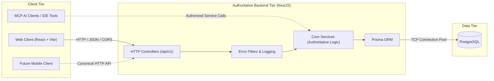
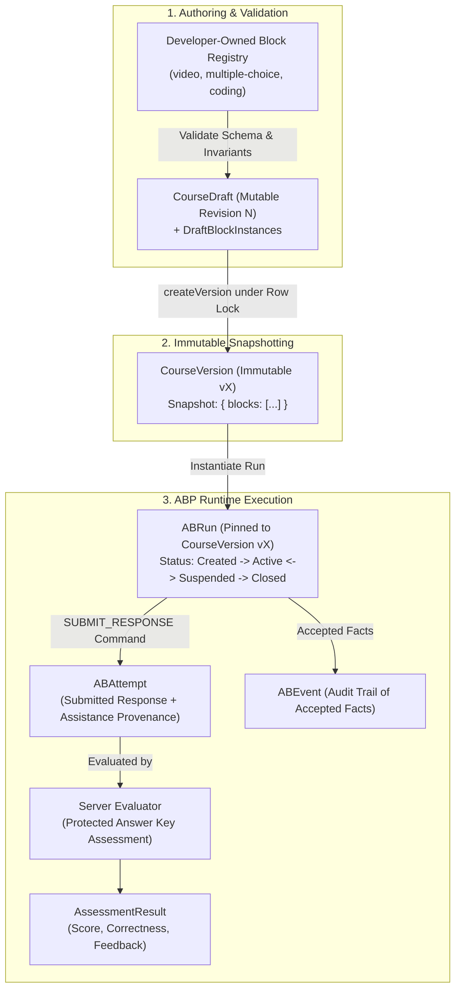

# ULE System Architecture Overview

## 1. System Topology & Tier Isolation

The Universal Learning Engine (ULE) is structured as a modular monorepo containing independently deployable frontend and backend applications, connected through a canonical, versioned REST API.



## 2. Core Architectural Principles

1. **Frontend Isolation**:
   - The React web application (`apps/web`) is strictly an HTTP client consuming the NestJS REST API.
   - It possesses zero direct database access, has no knowledge of PostgreSQL connection strings, and never imports Prisma or raw SQL queries.

2. **Authoritative Backend**:
   - Authoritative business logic, course verification, learner evaluations, and progress persistence reside exclusively in the NestJS application (`apps/api`).
   - The UI never computes or stores authoritative state.

3. **Canonical API Surface**:
   - Application endpoints are prefixed with `/api/v1`.
   - The API is formally documented via OpenAPI 3.0 at `/docs` (and `/docs-json`), allowing identical consumption by the React web client, future native mobile applications, and automated clients.

4. **MCP Tool Integration Strategy**:
   - Model Context Protocol (MCP) authoring and discovery tools, when introduced, must invoke the exact same authorized domain services as HTTP controllers.
   - MCP tools must not bypass business rules, authorization gates, or data integrity constraints.

5. **AI as an Unblocked, Optional Layer**:
   - Artificial intelligence runtime capabilities (e.g. adaptive quest generation, tutoring assistance) are non-blocking enhancement layers.
   - Core course creation, learning workflows, evaluation, and progress persistence must function deterministically without requiring an active AI model.

6. **Modular Monolith**:
   - The backend is organized as a modular monolith within a single deployable NestJS service.
   - Microservices, message brokers (Kafka/RabbitMQ), and distributed caches (Redis) are deliberately avoided until concrete scale or domain boundaries necessitate them.


## 3. Activity Block Protocol (ABP v0.2) & Minimal Runtime



### ABP Architectural Responsibilities
1. **Definition**: Developer-defined `ABTypeManifest` dictates structure, validation, schema, and capabilities. Creators cannot delete or weaken required structure.
2. **Configuration**: Creator-configured `DraftBlockInstance` inside an owned `CourseDraft`. Revisions participate in atomic optimistic locking.
3. **Snapshotting**: `CourseVersion` captures an immutable, validated snapshot of activities. Mutable draft edits never leak into historical versions.
4. **Runtime**: `ABRun` executes strictly against a pinned `CourseVersion`. Lifecycle follows `CREATED → ACTIVE ↔ SUSPENDED → CLOSED` (`COMPLETED`, `ABANDONED`, `FAILED`).
5. **Host Commands**: Commands are validated requests. Repeated requests with the same `idempotencyKey` prevent duplicate attempts or events.
6. **Events & Results**: Authoritative evaluation occurs on the server. Answer keys are strictly stripped from learner payloads.
7. **Learning Science Invariants**:
   - Video completion is ungraded and produces no score, pass, or mastery.
   - Assisted/hinted attempts retain distinct provenance from independent attempts.


## 4. Phase 3: Trusted Learning Evidence & Minimal LII Foundation

```mermaid
flowchart TD
    subgraph Access["1. Access Delegation"]
        Owner["Course Owner"] -->|Explicit Grant (CourseVersion)| Grant["CourseAccessGrant (ACTIVE)"]
        Learner["Registered Learner"] -->|Authorized via Grant| LearnerRun["Learner ABRun"]
    end

    subgraph RuntimeEvents["2. Authentic ABP Facts"]
        LearnerRun -->|Submit Response| Attempt["ABAttempt + AssessmentResult"]
        LearnerRun -->|Finish Video| Completion["RUN_COMPLETED (ungraded)"]
    end

    subgraph Ledger["3. Idempotent Evidence Ledger"]
        Attempt -->|Evaluated Ingestion| Ev1["LearningEvidence (EVALUATED)\nProvenance: SERVER_OBSERVED\nUnique: runId+attemptId+skillId"]
        Completion -->|Progress Ingestion| Ev2["LearningEvidence (COMPLETION_ONLY)\nNo Graded Score"]
    end

    subgraph Projections["4. Minimal LII Skill Projections"]
        Ev1 --> Projection["LearnerSkillProjection\nState: INSUFFICIENT_EVIDENCE\n| DEVELOPING | READY_TO_VERIFY\n(Never Premature Mastery)"]
        Ev2 -.->|Progress Metrics Only| Progress["Course Progress (0..100%)\nisMastered: false"]
    end
```

### Key Boundaries & Invariants
1. **Explicit Private Learner Access**: Private CourseVersions require explicit owner-issued `CourseAccessGrant` records. Grant revocation immediately prevents starting new runs and rejects in-flight commands (HTTP 403 Forbidden).
2. **Course-Scoped Skills & Versioned Snapshots**: Skills and block-to-skill mappings are course-scoped and freeze into immutable `CourseVersion.snapshot` upon version creation.
3. **Evidence Ledger Idempotency & Provenance**: Evidence is ingested deterministically with database uniqueness constraints (`[runId, attemptId, skillId]`). Server-delivered hints strictly enforce `SERVER_OBSERVED` assistance provenance, overriding client claims.
4. **Pedagogical Distinctions**:
   - Activity progress $\neq$ submitted attempt $\neq$ assessment result $\neq$ learning evidence $\neq$ skill state $\neq$ verified mastery claim.
   - Non-evaluatable video completion produces progress metrics only, never graded skill evidence or mastery.
   - Deferred feedback policy redacts correctness and scores until runs are `CLOSED (COMPLETED)`.
5. **Conservative Skill State Projections**: Deterministic projections derive `INSUFFICIENT_EVIDENCE`, `DEVELOPING`, or `READY_TO_VERIFY` states with transparent reasoning and missing evidence explanations. `VERIFIED` mastery is strictly out of scope for this slice and is never granted.
6. **Append-Only Assessment Corrections**: Corrections append an auditable `AssessmentCorrection` record and idempotently re-evaluate affected evidence and skill projections without mutating history.

