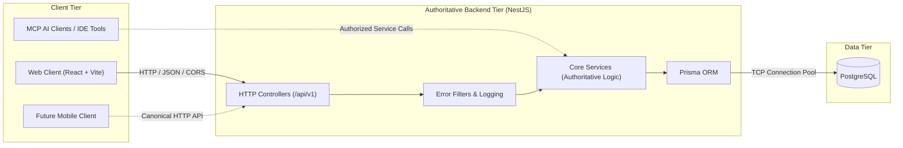

# ULE System Architecture Overview

## 1. System Topology & Tier Isolation

The Universal Learning Engine (ULE) is structured as a modular monorepo containing independently deployable frontend and backend applications, connected through a canonical, versioned REST API.

## 2. Core Architectural Principles

1. **Frontend Isolation**:
   - The React web application (`apps/web`) is strictly an HTTP client consuming the NestJS REST API.
   - It possesses zero direct database access, has no knowledge of PostgreSQL connection strings, and never imports Prisma or raw SQL queries.

2. **Authoritative Backend**:
   - Authoritative business logic, course verification, learner evaluations, and progress persistence reside exclusively in the NestJS application (`apps/api`).
   - The UI never computes or stores authoritative state.

3. **Canonical API Surface**:
   - Application endpoints are prefixed with `/api/v1`.
   - The API is formally documented via OpenAPI 3.0 at `/docs` (and `/docs-json`), allowing identical consumption by the React web client, future native mobile applications, and automated clients.

4. **MCP Tool Integration Strategy**:
   - Model Context Protocol (MCP) authoring and discovery tools, when introduced, must invoke the exact same authorized domain services as HTTP controllers.
   - MCP tools must not bypass business rules, authorization gates, or data integrity constraints.

5. **AI as an Unblocked, Optional Layer**:
   - Artificial intelligence runtime capabilities (e.g. adaptive quest generation, tutoring assistance) are non-blocking enhancement layers.
   - Core course creation, learning workflows, evaluation, and progress persistence must function deterministically without requiring an active AI model.

6. **Modular Monolith**:
   - The backend is organized as a modular monolith within a single deployable NestJS service.
   - Microservices, message brokers (Kafka/RabbitMQ), and distributed caches (Redis) are deliberately avoided until concrete scale or domain boundaries necessitate them.
