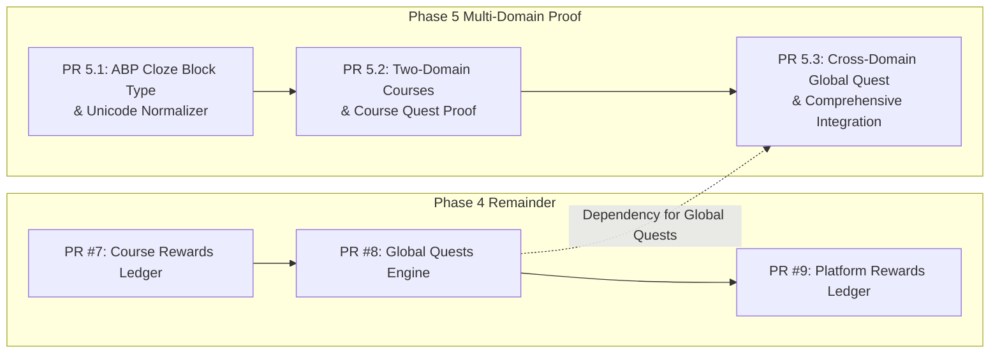

# ULE Phase 5: Multi-Domain Proof
## D0 Architecture, Dependency Audit & Implementation Planning

> **Status**: Architecture Proposal & D0 Readiness Audit  
> **Date**: 30 October 2026  
> **Repository**: `17thedevv/ULE`  
> **Baseline Commit**: `4aa7171` (`main` HEAD, PR #6 merged)  
> **Decision**: **CONDITIONAL GO** (Proceed with Domain A & Domain B multi-course slice; sequence PR #7-#9 for live Platform Rewards & Global Quests)

---

## 1. Repository & Baseline Audit

### 1.1 Git & Branch Topology
A direct audit of `17thedevv/ULE` confirms:
- **`main` Branch HEAD**: [`4aa7171`](https://github.com/17thedevv/ULE/commit/4aa717153b6f0e34c9c6fca66bc0f82329dc3309) — *Merge pull request #6 from 17thedevv/feat/phase-4-course-quests*.
- **Closed Pull Requests**: PR #1 (Bootstrap), PR #2 (Phase 1A Course Core), PR #3 (Phase 1B ABP Runtime), PR #4 (Phase 2 MCP Authoring), PR #5 (Phase 3 Learning Evidence & LII), and PR #6 (Phase 4 Course Quests & Qualification).
- **Active Open Pull Requests**: None (0 open PRs).

### 1.2 GitHub Actions CI Status
GitHub Actions CI Run **#41023223963** on `main` HEAD (`4aa7171`) completed with **success**:
- **Job 1 (Lint, Typecheck, Build & Unit Tests)**:
  * ESLint: 0 errors, 0 warnings.
  * TypeScript type check: clean across all packages (`@ule/contracts`, `@ule/api`, `@ule/web`).
  * API Unit & Contract Tests: 60/60 passing (10 test suites).
  * Web Unit Tests: 15/15 passing (4 test files).
  * API E2E Tests: 25/25 passing (2 test suites).
- **Job 2 (PostgreSQL Migration & Real DB Integration)**:
  * Prisma Migrations Applied: 10/10 migrations clean.
  * Real PostgreSQL Integration Tests: 222/222 passing (8 test suites, including all 39 Course Quests integration tests).

---

## 2. Phase 4 Prerequisite Readiness Audit

To establish an uncompromised foundation for Phase 5, each required Phase 4 capability has been audited against repository reality:

| # | Capability | Status | File Paths & Implementation Evidence | Integration Tests | Missing Elements / Dependencies |
| :--- | :--- | :---: | :--- | :--- | :--- |
| **1** | **Course Quests & Qualification Pipeline** | **COMPLETE** | • Authoring: `apps/api/src/modules/quests/draft-quests.service.ts`<br>• Registry: `apps/api/src/modules/quests/quest-templates.registry.ts`<br>• Enrollment: `apps/api/src/modules/quests/enrollment.service.ts`<br>• Fact Pipeline: `apps/api/src/modules/quests/qualification.service.ts`<br>• Engine: `apps/api/src/modules/quests/quest-engine.service.ts`<br>• Schema: `CourseEnrollment`, `DraftCourseQuest`, `QualifyingFact`, `QuestInstance`, `QuestObjectiveProgress`, `QuestFactConsumption` | `apps/api/test/course-quests.integration.spec.ts` (39/39 passing) | None for Course Quests. Anti-leak DEFERRED predicate (`isEvaluationReleaseEligible`) and 2-way assessment correction reconciliation are fully operational. |
| **2** | **Course Reward Ledger & Reconciliation** | **PARTIAL** | • Contracts: `CourseQuestRewardPolicyDto` (`packages/contracts/src/quests.ts`)<br>• Validation: `DraftQuestsService.validateRewardPolicy` enforces strict allowlist (`courseXp`, `badgeKey`)<br>• Reversal: `QualificationService.reconcileAssessmentCorrection` revokes consumption and decrements objective progress | Tested via quest status and fact consumption in `course-quests.integration.spec.ts` | **Missing PR #7**: `CourseRewardGrant` and `CourseRewardAdjustment` tables, `CourseRewardsService`, and balance projection endpoint (`GET /api/v1/learner/courses/:versionId/rewards`). |
| **3** | **Global Quests with ULE-Owned Policies** | **MISSING** | • Schema: `QuestInstance.scope` (`String @default("COURSE")`) and nullable `courseEnrollmentId` / `courseVersionId` are present in schema | None | **Missing PR #8**: Global Quest definitions registry, platform quest runner, multi-course fact query in `QuestEngineService.processFact` (currently filtered by `courseVersionId`). |
| **4** | **Platform Reward Ledger & Economy Isolation** | **MISSING** | • Contracts: `PlatformQuestRewardPolicyDto` (`packages/contracts/src/quests.ts`)<br>• Guard: Creators strictly forbidden from setting `platformXp` in course quests | None | **Missing PR #9**: `PlatformRewardGrant` and `PlatformRewardAdjustment` models, platform reward service, and platform balance projection. |
| **5** | **Deterministic Journey Planner** | **MISSING** | • ADR-012 defines R0-R3 revision lifecycle, 4 edge types, and multi-factor ranking | None | **Missing PR #10**: Journey planner module, goal capture, DAG generation, preference ranking service. |
| **6** | **Learner-Facing Quest & Journey UX** | **PARTIAL** | • Backend API: `GET /api/v1/learner/courses/:versionId/quests` and `GET /enrollment` implemented in `apps/api/src/modules/quests/learner-quests.controller.ts` | Verified via HTTP integration tests in `course-quests.integration.spec.ts` | Web UI frontend components for displaying Quests, Objectives, or Journeys in `apps/web` are not yet built. |

> [!IMPORTANT]
> **Audit Conclusion**: Phase 4 is **partially complete** (PR #6 merged; PR #7-#10 pending). Phase 5 must not simulate missing Phase 4 capabilities as complete. Specifically, cross-domain Global Quest execution and Platform Reward issuance require PR #7, PR #8, and PR #9.

---

## 3. Phase 5 Objective & Multi-Domain Architecture

### 3.1 Core Invariant: Zero Domain Branching
```
❌ FORBIDDEN:
if (course.domain === 'math') { ... }
if (block.domain === 'english') { ... }
switch (quest.subject) { ... }

✅ REQUIRED:
All domains use identical canonical models:
CourseDraft ──> CourseVersion (Immutable Snapshot) ──> CourseAccessGrant ──> CourseEnrollment
      │
      └──> BlockTypeRegistry (allowlisted ABTypeManifest)
                 │
                 ├──> video (ungraded lecture / presentation)
                 ├──> multiple-choice (deterministic option selection)
                 └──> cloze (deterministic normalized token evaluation)
```

No field named `domain`, `subject`, `mathConfig`, or `englishConfig` shall be added to `Course`, `CourseVersion`, `CourseDraft`, `ABRun`, `ABAttempt`, `QualifyingFact`, or `QuestInstance`. All domain-specific pedagogy is encapsulated behind validated Activity Block type definitions and server evaluator interfaces.

---

### 3.2 Domain Comparison Matrix

| Architectural Dimension | Domain A: Mathematics | Domain B: English Language Learning |
| :--- | :--- | :--- |
| **Course Subject** | Algebra & Arithmetic Reasoning | Syntax, Vocabulary & Reading Comprehension |
| **Primary Activities** | 1. Introduction Video (`video`)<br>2. Algebraic Linear Equations (`multiple-choice`) | 1. Reading Comprehension Passage (`multiple-choice`)<br>2. Bounded Sentence Completion (`cloze`) |
| **Evaluation Mechanism** | Server-authoritative selection of algebraic solution option (distractor analysis) | 1. Passage comprehension MCQ<br>2. Deterministic Unicode NFKC normalized token matching (Cloze) |
| **Answer Key Protection** | Correct option ID and mathematical derivation stripped from learner payloads | Correct option ID, passage explanations, and acceptable token variants stripped from learner payloads |
| **Assistance Tracking** | Hints provide intermediate algebraic step; delivers `SERVER_OBSERVED` assistance | Hints provide part of speech or contextual synonym; delivers `SERVER_OBSERVED` assistance |
| **Open-Ended Text Fallacy** | N/A (Symbolic/numerical multiple-choice) | Strictly avoids open-ended essay matching. Bounded to closed-set grammatical/lexical targets. No AI/LLM evaluation. |
| **Fact Qualification** | `ACTIVITY_COMPLETED` (video, MCQ)<br>`INDEPENDENT_PRACTICE_CONFIRMED` (unassisted correct MCQ) | `ACTIVITY_COMPLETED` (MCQ, Cloze)<br>`INDEPENDENT_PRACTICE_CONFIRMED` (unassisted correct Cloze/MCQ) |
| **Course Quests** | 1. Complete Distinct Activities (Target: 2)<br>2. Independent Practice Milestone (Target: 1, `SKILL_MATH_ALGEBRA`) | 1. Complete Distinct Activities (Target: 2)<br>2. Independent Practice Milestone (Target: 1, `SKILL_ENG_SYNTAX`) |

---

### 3.3 Allowlisted ABP Extension: `cloze` Block Type

To prove multi-domain versatility without falling into the "string matching fallacy", we design a versioned, allowlisted ABP extension: `cloze` (v1.0.0).

#### A. Type Manifest
- **ID**: `cloze`
- **Version**: `1.0.0`
- **Capabilities**: `renderable: true`, `submittable: true`, `evaluatable: true`, `completable: true`, `runtimeExecutionSupported: true`.

#### B. Configuration Schema (`schemaDescription`)
```json
{
  "type": "object",
  "required": ["prompt", "templateText", "targetBlanks", "answerKey"],
  "properties": {
    "prompt": { "type": "string", "minLength": 5 },
    "templateText": { "type": "string" }, // e.g. "The scientist conducted an {{blank_1}} to verify the hypothesis."
    "targetBlanks": {
      "type": "array",
      "minItems": 1,
      "maxItems": 5,
      "items": {
        "type": "object",
        "required": ["id", "blankKey"],
        "properties": {
          "id": { "type": "string" },
          "blankKey": { "type": "string" },
          "hintText": { "type": "string" }
        }
      }
    },
    "answerKey": {
      "type": "object",
      "required": ["blanks"],
      "properties": {
        "blanks": {
          "type": "object",
          "additionalProperties": {
            "type": "array",
            "items": { "type": "string" }
          }
        },
        "explanation": { "type": "string" }
      }
    },
    "feedbackPolicy": {
      "type": "string",
      "enum": ["IMMEDIATE_WITH_EXPLANATION", "IMMEDIATE_CORRECTNESS_ONLY", "DEFERRED"]
    }
  }
}
```

#### C. Deterministic Unicode Text Normalization Engine
To ensure linguistic correctness across platforms, alphabets, and user inputs, the server-side Cloze evaluator executes:
$$\text{normalizedToken} = \text{input}.\text{normalize}('NFKC').\text{trim}().\text{toLowerCase}().\text{replace}(/[.,/#!$%^&*;:{}=\-_`~()]/g, '')$$
- Strips accents and diacritics where appropriate, handles Unicode apostrophes (`’` vs `'`), and rejects wildcards or regex injection.
- Evaluates against an allowlisted set of accepted variants authored by the educator (e.g. `['experiment', 'investigation']`).
- **No AI / Speech Recognition**: Fully server-deterministic, repeatable in $O(1)$ time.

---

## 4. Cross-Domain Global Quest Dependency Analysis

### 4.1 The Architectural Requirement
Phase 5 requires demonstrating a ULE-owned Global Quest progressing from facts across both the Mathematics and English courses (e.g. *"Dual-Domain Scholar: Achieve 1 independent practice milestone in 2 different courses"*).

### 4.2 Dependency Gap in Current Codebase
1. **Query Boundary**: In [`apps/api/src/modules/quests/quest-engine.service.ts`](file:///d:/Project-17/ULE/apps/api/src/modules/quests/quest-engine.service.ts#L25-L33):
   ```ts
   const candidateInstances = await tx.questInstance.findMany({
     where: {
       userId: fact.userId,
       courseVersionId: fact.courseVersionId, // <── Constrained to single course!
       status: 'ACTIVE',
     },
     select: { id: true },
     orderBy: { id: 'asc' },
   });
   ```
   Global quests (where `courseVersionId` is `null` and `scope` is `'GLOBAL'`) are never queried or updated by `QuestEngineService`.
2. **Lifecycle Management**: Course quests are instantiated upon enrollment from `CourseVersion.snapshot.quests`. No global quest registry, enrollment mechanism, or platform lifecycle manager currently exists (pending PR #8).
3. **Reward Settlement**: Global quests reward `platformXp`, but no Platform Reward Ledger exists to accept grants or record adjustments (pending PR #9).

### 4.3 Proposed Architectural Solution
Rather than conflating Phase 5 with a hasty, unverified implementation of PR #8 and PR #9:
- **Phase 5 D0 Recommendation**:
  1. Prove multi-domain Course Core, ABP runtime (`multiple-choice` + `cloze`), facts, and Course Quests in PR 5.1 & PR 5.2.
  2. Implement Phase 4 PR #7 (Course Rewards) and PR #8 (Global Quests) either before or in coordination with PR 5.3.
  3. PR 5.3 then delivers the cross-domain integration test verifying live multi-course Global Quest progression without mocking or state bypass.

---

## 5. Phase 5 PR-by-PR Implementation Roadmap



### PR 5.1: Allowlisted ABP Extension — `cloze` Block Type & Normalization Engine
- **Scope**:
  * Add `ClozeBlockDefinition` to `apps/api/src/modules/abp/registry/types/cloze.block.ts`.
  * Add shared DTOs & contracts in `packages/contracts/src/abp.ts`.
  * Register in `BlockTypeRegistry` (`apps/api/src/modules/abp/registry/block-type.registry.ts`).
  * Unit tests verifying config validation, answer key stripping, and Unicode normalization ($NFKC$, case folding, whitespace, punctuation).
- **Files**:
  * `packages/contracts/src/abp.ts`
  * `apps/api/src/modules/abp/registry/types/cloze.block.ts`
  * `apps/api/src/modules/abp/registry/block-type.registry.ts`
  * `apps/api/test/abp-cloze-block.spec.ts`
- **Dependencies**: None.

### PR 5.2: Multi-Domain Courses, Snapshots & Course Quest Verification
- **Scope**:
  * Create Mathematics course with Video + MCQ (`SKILL_MATH_ALGEBRA`).
  * Create English course with Passage MCQ + Cloze (`SKILL_ENG_SYNTAX`).
  * Freeze both into immutable `CourseVersion` snapshots.
  * Enroll independent learners with `CourseAccessGrant`.
  * Verify independent practice milestone quests in both domains.
  * Verify assistance tracking, repetition prevention, and DEFERRED anti-leak across both courses.
- **Files**:
  * `apps/api/test/multi-domain-proof.integration.spec.ts`
- **Dependencies**: PR 5.1.

### PR 5.3: Cross-Domain Fact Qualification & Global Quest Integration
- **Scope**:
  * Update `QuestEngineService.processFact` to query both course-scoped and active global quest instances:
    `OR: [{ courseVersionId: fact.courseVersionId }, { scope: 'GLOBAL', courseVersionId: null }]`.
  * Instantiate ULE-owned Global Quest (e.g. `multi-domain-explorer`, Target: 1 practice fact in Course A and 1 in Course B).
  * Verify exactly-once fact consumption, replay idempotency, and anti-leak across courses.
  * Verify that assessment correction in Course B reconciles global quest progress without affecting Course A facts.
- **Files**:
  * `apps/api/src/modules/quests/quest-engine.service.ts`
  * `apps/api/test/cross-domain-global-quest.integration.spec.ts`
- **Dependencies**: PR 5.2, Phase 4 PR #8.

---

## 6. Proposed ADR-013: Multi-Domain Proof & Allowlisted Cloze Block Extension

```markdown
## ADR-013: Multi-Domain Learning Proof and Cloze Block Extension

- **Status**: Proposed (Phase 5 D0)
- **Context**: ULE must prove pedagogical generality across at least two disparate subjects (Mathematics and English Language Learning) without introducing domain-specific branching or contaminating the canonical Course, Quest, or Evidence state engines.
- **Decision**:
  1. Strict Domain Agnosticism in Core:
     - No `domain` or `subject` columns in Course, Version, Run, or Quest models.
     - All domain variability resides strictly inside Activity Block manifests and server evaluators.
  2. Cloze Block Type Addition:
     - Allowlist `cloze` (v1.0.0) in the developer-owned `BlockTypeRegistry`.
     - Standardize text evaluation on Unicode NFKC normalization, case folding, and whitespace collapsing.
     - Ban open-ended free text matching and speech recognition in this slice.
  3. Global Quest Engine Extension:
     - Extend `QuestEngineService.processFact` to match both course-scoped instances and platform-scoped global quest instances under the same sorted row-locking hierarchy.
- **Consequences**: Confirms ULE as a true Universal Learning Engine while maintaining strict transaction boundaries, learning science invariants, and pedagogical integrity.
```

---

## 7. Implementation & Verification Summary

- **Branch**: `feat/phase-5-multi-domain-proof`
- **Commit**: [`5f8c203`](https://github.com/17thedevv/ULE/commit/5f8c203797cff06da1b284889542f436fe72549e)
- **ADR-013**: Accepted and codified in `docs/architecture/decisions.md`.
- **Verification Gates Achieved**:
  1. **Gate 1 (Math Domain Authoring & Snapshotting)**: Course A created with Video, Algebraic Derivation MCQ, skill mapping (`SKILL_MATH_ALGEBRA`), and 2 course quests (`math-distinct`, `math-practice`), frozen into CourseVersion v1.
  2. **Gate 2 (English Domain Authoring & Snapshotting)**: Course B created with Reading MCQ, Cloze fill-in-the-blank, skill mapping (`SKILL_ENG_SYNTAX`), and 2 course quests (`eng-distinct`, `eng-practice`), frozen into CourseVersion v1.
  3. **Gate 3 (Enrollment & Authorization)**: Independent learner enrollment requiring active owner-issued `CourseAccessGrant` verified across both courses.
  4. **Gate 4 (Cloze ABP Extension)**: Sanitized learner projections strip educator answer keys and explanations; deterministic server evaluator verifies Unicode NFKC normalization, case folding, punctuation stripping, and diacritics variants (`français`).
  5. **Gate 5 (Math Assessment & Quest Progression)**: Video increments distinct participation (1/2); unassisted correct algebraic MCQ derivation completes both distinct and independent practice quests.
  6. **Gate 6 (English Assessment & Quest Progression)**: Reading MCQ increments distinct participation (1/2); unassisted correct Cloze sentence completion completes both distinct and independent practice quests.
  7. **Gate 7 (Replay & Qualification Idempotency)**: Replays in both domains result in zero duplicate facts or double-counted quest progress.
  8. **Gate 8 (Assistance Provenance Distinction)**: Server-observed hints (`SERVER_OBSERVED`) delivered on Math MCQ or English Cloze explicitly exclude attempts from independent practice qualification (`math-practice` and `eng-practice` remain 0).
  9. **Gate 9 (Deferred Feedback Confidentiality)**: Correctness and feedback withheld while run is ACTIVE/SUSPENDED; abandoning a deferred run NEVER qualifies; completing a deferred run reconciles upon CLOSED COMPLETED.
  10. **Gate 10 (Cross-Domain Global Quest Progression)**: Platform-owned quest (`polymath-explorer`, `scope: GLOBAL`) progresses across distinct courses (1 fact from Math + 1 fact from English = 2/2 COMPLETED) with zero double-counting.
  11. **Gate 11 (Two-Way Assessment Reconciliation)**: Re-grading in both Math and English from correct to incorrect supercedes fact, revokes consumption, decrements quest count, and reverts quest status to ACTIVE; re-grading back to correct restores fact, consumption, and COMPLETED status.
  12. **Gate 12 (Zero Domain Branching Invariant)**: Automated schema reflection verifies 0 domain-specific columns in `Course`, `CourseVersion`, `QuestInstance`, `QualifyingFact`, `ABRun`, `AssessmentResult`, `CourseEnrollment`, and `CourseAccessGrant`.

### Test Execution Metrics
- **Multi-Domain Proof Integration Suite**: 26/26 tests passing (`apps/api/test/multi-domain-proof.integration.spec.ts`).
- **ABP Cloze Unit Suite**: 29/29 tests passing (`apps/api/test/abp-cloze-block.spec.ts`).
- **Monorepo API Unit Tests**: 73/73 tests passing (11 suites).
- **Monorepo Web Unit Tests**: 15/15 tests passing (4 suites).
- **Monorepo Integration Tests**: 248/248 tests passing (9 suites against PostgreSQL).
- **TypeScript & ESLint Quality Gates**: 0 errors, 0 warnings.
